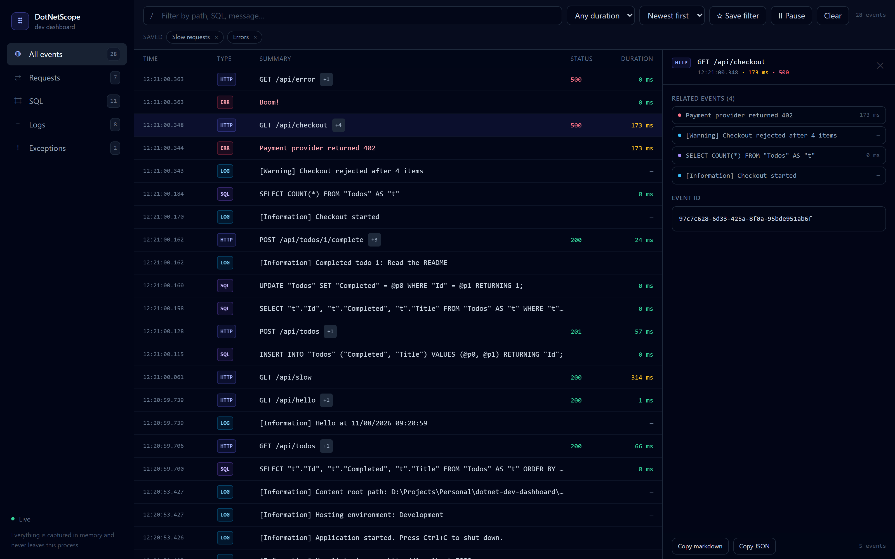
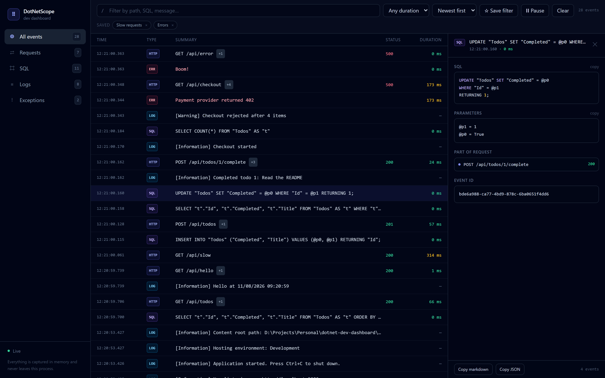
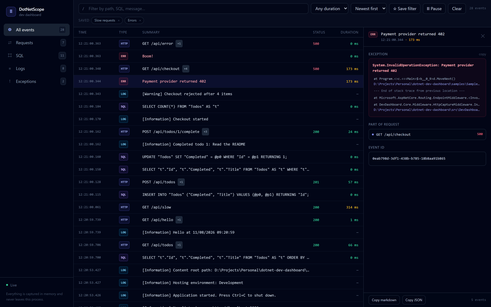

# DotNetScope

[](https://github.com/PersiOnOff/dotnet-scope/actions/workflows/ci.yml)
[](https://www.nuget.org/packages/DotNetScope)
[](LICENSE)


**A self-hosted dev dashboard for ASP.NET Core.** HTTP requests, EF Core SQL, logs and exceptions in one real-time timeline — grouped by the request that caused them.

No agent. No cloud account. No telemetry leaving your machine. Three lines of code and a tab at `/_dashboard`.



---

## Why another dashboard?

Most .NET observability tools are built for production: you configure exporters, ship data somewhere, and pay for the storage. But 90% of the debugging you actually do happens on your laptop, and the question is always the same:

> “This endpoint returned 500 — which SQL ran, and what did the log say right before it blew up?”

DotNetScope answers exactly that, in process, with zero configuration:

| | DotNetScope | Seq / Serilog UI | .NET Aspire dashboard | MiniProfiler | App Insights |
|---|---|---|---|---|---|
| Setup | 3 lines: `AddDevDashboard()` + `UseDevDashboard()` + `UseDevDashboardEndpoints()` | sink + server (+ licence) | Aspire orchestration | package + middleware | cloud resource + key |
| Sees HTTP + SQL + logs + exceptions together | ✅ correlated by request | logs only | ✅ but Aspire-hosted | mostly SQL/timing | ✅ after ingestion |
| Data leaves your machine | never | optional | no | no | always |
| Works in a plain `dotnet run` | ✅ | ✅ | ❌ needs AppHost | ✅ | ✅ |

DotNetScope is not a replacement for production observability. It is the thing you open while writing the code.

## What you get

- **One timeline, four event types** — requests, EF Core commands, `ILogger` records and unhandled exceptions, newest first.
- **Request correlation** — every SQL command and log line is tagged with the request that produced it. Click the request, see its children.
- **Search, filters, saved views** — free-text search across path, SQL, parameters and messages; filter by type and by duration (`> 100 ms`, `> 500 ms`, `> 1 s`); save a combination as a named chip that survives a reload.
- **Slowest-first view** — sort the whole stream by duration to find the request that actually hurt.
- **One-click export** — copy a request with its SQL, logs and stack trace as markdown for an issue, or as JSON for a script.
- **SQL you can read** — syntax highlighting, parameters rendered separately from the command text.
- **Exceptions that make sense** — message, stack frames highlighted, one click to copy a frame.
- **Bodies on demand** — request and response bodies, JSON pretty-printed.
- **Live over SignalR** — pause the stream when a noisy endpoint floods the list.
- **Local-only by default** — remote access is opt-in, because this data is sensitive.
- **Nothing to configure** — the UI is embedded in the assembly and served from `/_dashboard`.

<p align="center">
  
  
</p>

## Quick start

```bash
dotnet add package DotNetScope
```

```csharp
var builder = WebApplication.CreateBuilder(args);

builder.Services.AddDevDashboard();          // 1. register

var app = builder.Build();

app.UseDevDashboard();                       // 2. capture + serve the UI
app.MapGet("/api/todos", () => "hello");
app.UseDevDashboardEndpoints();              // 3. map the hub and JSON API

app.Run();
```

Run the app, make a request, open **`http://localhost:5000/_dashboard`**.

> The package is published from this repository's releases. Until the first release lands on nuget.org, run the sample below or reference the project directly.

### Run the sample

```bash
git clone https://github.com/PersiOnOff/dotnet-scope.git
cd dotnet-scope
dotnet run --project samples/SampleWebApi
# then in another terminal
curl http://localhost:5000/api/todos
curl http://localhost:5000/api/checkout
```

Open <http://localhost:5000/_dashboard>. `samples/SampleWebApi` is a small EF Core + SQLite API with a few endpoints that deliberately log, query and throw so you can see every event type.

## Configuration

```csharp
builder.Services.AddDevDashboard(options =>
{
    options.AllowRemoteAccess = false;   // default: loopback only
    options.MaxEvents = 1000;            // in-memory ring buffer
    options.CaptureResponseBodies = true;
    options.CaptureRequestBodies = true;
    options.MaxBodyChars = 4000;
    options.ExcludedCategories.Add("MyApp.Noisy.Category");
});
```

| Option | Default | Purpose |
|---|---|---|
| `Enabled` | `true` | Turn every dashboard route into a 404 without removing the package. |
| `AllowRemoteAccess` | `false` | Allow non-loopback callers. Enable only behind your own auth. |
| `MaxEvents` | `1000` | How many events are kept in memory. Oldest are dropped. |
| `CaptureResponseBodies` | `true` | Capture text response bodies (bounded by `MaxBodyChars`). |
| `CaptureRequestBodies` | `true` | Capture JSON/text/form request bodies. |
| `MaxBodyChars` | `4000` | Per-body character cap. |
| `ExcludedCategories` | framework noise | Logger category prefixes that are ignored. |

## JSON API

Everything the UI shows is also available as JSON, so you can script it in CI or from a terminal:

| Endpoint | Purpose |
|---|---|
| `GET /_dashboard/api/events?type=&q=&minDurationMs=&limit=` | filtered event list |
| `GET /_dashboard/api/requests/{id}` | one request with its SQL, logs and exceptions |
| `GET /_dashboard/api/info` | version and retained event count |
| `DELETE /_dashboard/api/events` | clear the in-memory buffer |

## How it works

```
        HTTP request
             │
   ┌─────────▼──────────┐     response copy (bounded)
   │ HttpCaptureMiddleware │──────────────────────┐
   └─────────┬──────────┘                        │
             │  request id (AsyncLocal)          │
   ┌─────────▼──────────┐   ┌──────────────────┐ │
   │ ILoggerProvider    │   │ EF Core          │ │
   │ (log events)       │   │ DiagnosticSource │ │
   └─────────┬──────────┘   └────────┬─────────┘ │
             │                       │           │
             └───────────┬───────────┴───────────┘
                         ▼
               InMemoryTelemetryStore  ──►  SignalR hub  ──►  embedded React UI
```

- `HttpCaptureMiddleware` times the request, correlates child events through an `AsyncLocal` request id, and keeps a bounded copy of the response without buffering the whole stream.
- `DashboardLoggerProvider` is an `ILoggerProvider` that mirrors records into the store (framework chatter is filtered out).
- `SqlDiagnosticListener` subscribes to the EF Core `DiagnosticListener` and captures `CommandExecuted` with parameters and duration.
- The UI is a React + Tailwind + SignalR bundle compiled into `wwwroot` and embedded into the assembly as a `ManifestEmbeddedFileProvider`.

## Security

This is a **development tool**. It captures SQL parameters, request bodies and stack traces, so it is deliberately locked down:

- every `/_dashboard` route answers **403** unless the caller is loopback;
- `AllowRemoteAccess = true` is required to expose it, and the README will not stop you — put authentication in front of it;
- `Enabled = false` removes it entirely;
- nothing is written to disk and nothing is sent anywhere.

Found a security issue? Please read [SECURITY.md](SECURITY.md) instead of opening a public issue.

## Build from source

```bash
# UI (emits into src/DevDashboard.Core/wwwroot)
cd src/DevDashboard.UI && npm ci && npm run build && cd ../..

dotnet build src/DevDashboard.Core/DevDashboard.Core.csproj
dotnet test tests/DevDashboard.Tests/DevDashboard.Tests.csproj
dotnet pack src/DevDashboard.Core/DevDashboard.Core.csproj -c Release -o artifacts
```

Requirements: .NET 10 SDK, Node 20+ for the UI. `DevDashboard.sln` is there for IDEs; the commands above build the projects directly so they also work on machines with a picky solution-level MSBuild.

## Project layout

```
src/DevDashboard.Core   the package: middleware, interceptors, store, hub, API, embedded UI
src/DevDashboard.UI     React + Tailwind + Vite front end
samples/SampleWebApi    runnable demo (EF Core + SQLite)
tests/DevDashboard.Tests integration and unit tests (real Kestrel host)
```

## Roadmap

- [x] Export a request (with its SQL and logs) as a shareable JSON/markdown block
- [x] Saved filters and a “slowest requests” view
- [ ] Database tab: browse tables of a SQLite/SQL Server connection
- [ ] Light theme
- [ ] OpenTelemetry span correlation

Ideas and pull requests are welcome — see [CONTRIBUTING.md](CONTRIBUTING.md).

## License

MIT — see [LICENSE](LICENSE).

---

If DotNetScope saved you a debugging session, a ⭐ helps other .NET developers find it.
