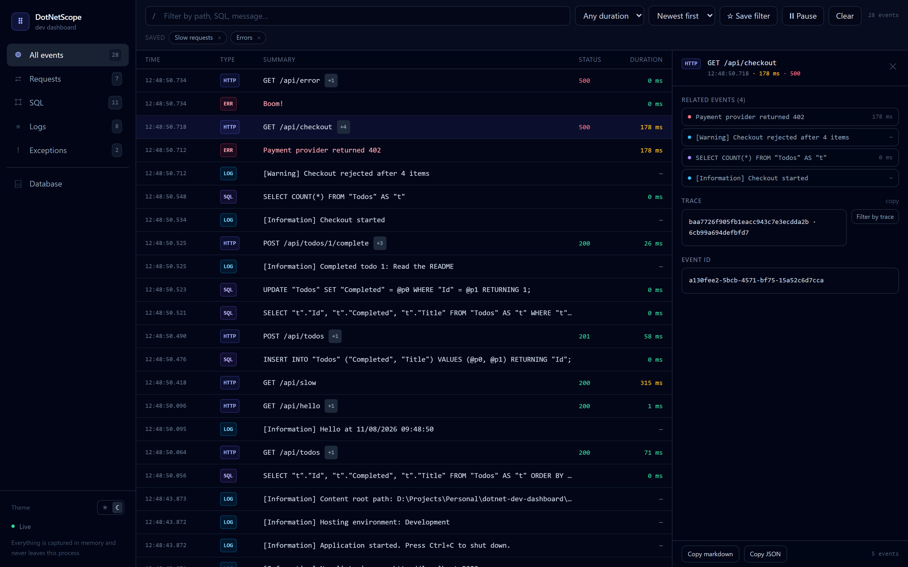
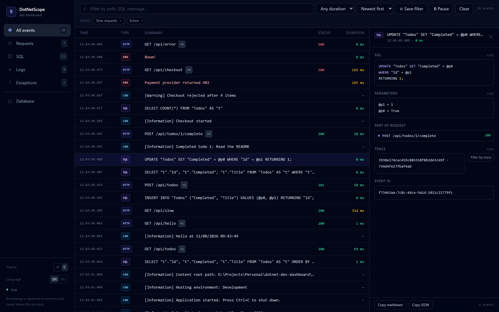
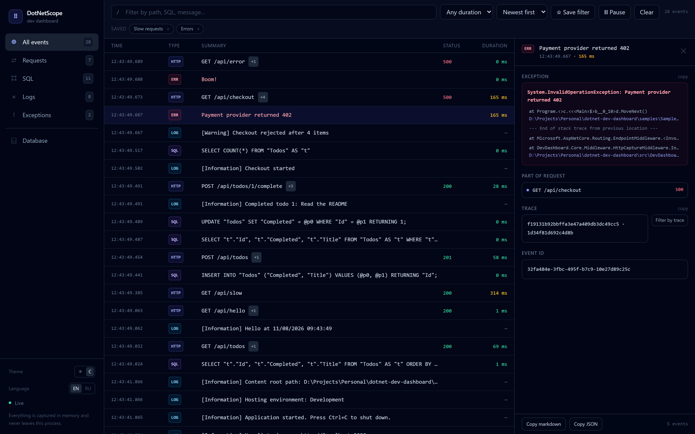
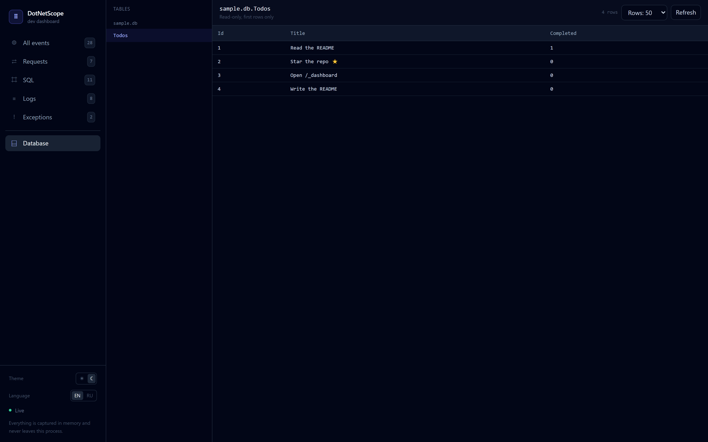
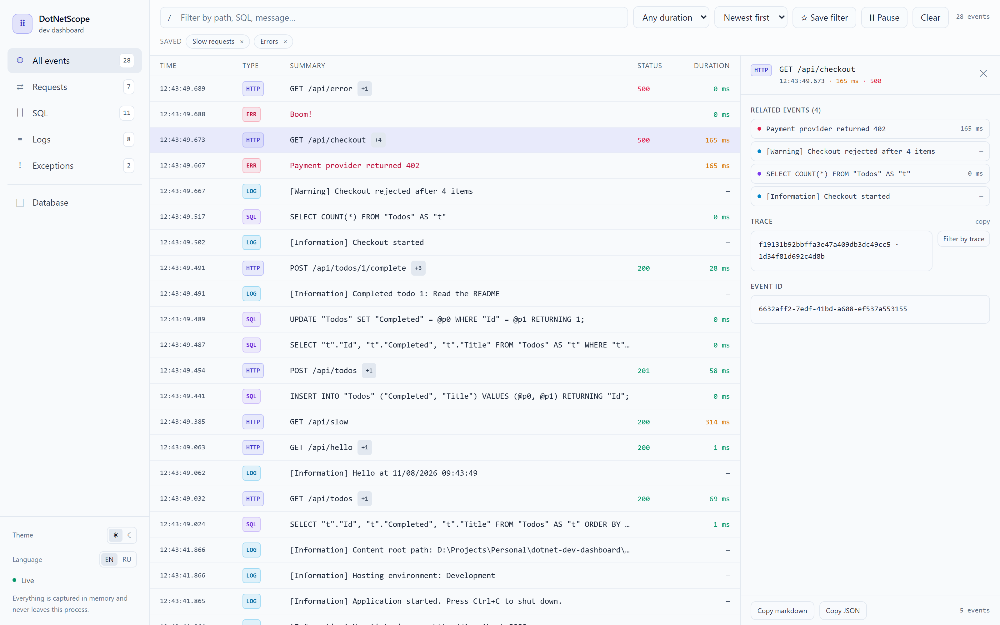

# DotNetScope

[](https://github.com/PersiOnOff/dotnet-scope/actions/workflows/ci.yml)
[](https://www.nuget.org/packages/DotNetScope)
[](LICENSE)


[English](README.md) · **Русский**

**Self-hosted dev-дашборд для ASP.NET Core.** HTTP-запросы, SQL от EF Core, логи и исключения в одной ленте реального времени — сгруппированные по запросу, который их вызвал.

Без агента. Без облачного аккаунта. Без телеметрии, уходящей с вашей машины. Три строки кода и вкладка на `/_dashboard`.



---

## Зачем ещё один дашборд?

Большинство инструментов наблюдаемости для .NET сделаны для продакшена: настроить экспортёры, отправить данные куда-то, платить за хранение. Но почти вся отладка происходит на ноутбуке, и вопрос всегда один:

> «Этот эндпоинт вернул 500 — какой SQL выполнился и что было в логе прямо перед падением?»

DotNetScope отвечает ровно на это, в процессе, без конфигурации:

| | DotNetScope | Seq / Serilog UI | .NET Aspire dashboard | MiniProfiler | App Insights |
|---|---|---|---|---|---|
| Установка | 3 строки: `AddDevDashboard()` + `UseDevDashboard()` + `UseDevDashboardEndpoints()` | sink + сервер (+ лицензия) | оркестрация Aspire | пакет + middleware | облачный ресурс + ключ |
| Видит HTTP + SQL + логи + исключения вместе | ✅ связаны по запросу | только логи | ✅ но хостится в Aspire | в основном SQL и тайминги | ✅ после загрузки |
| Данные покидают машину | никогда | опционально | нет | нет | всегда |
| Работает в обычном `dotnet run` | ✅ | ✅ | ❌ нужен AppHost | ✅ | ✅ |

DotNetScope не заменяет продакшен-наблюдаемость. Это то, что вы открываете, пока пишете код.

## Что внутри

- **Одна лента, четыре типа событий** — запросы, команды EF Core, записи `ILogger` и необработанные исключения, новые сверху.
- **Корреляция по запросу** — каждый SQL-запрос и каждая строка лога помечены запросом, который их породил. Нажмите на запрос — увидите его «детей».
- **Поиск, фильтры, сохранённые виды** — полнотекстовый поиск по пути, SQL, параметрам и сообщениям; фильтр по типу и длительности (`> 100 мс`, `> 500 мс`, `> 1 с`); комбинация сохраняется как именованный чип и переживает перезагрузку.
- **Сортировка «сначала медленные»** — переключите порядок и найдите запрос, который действительно болел.
- **Экспорт в один клик** — скопировать запрос с SQL, логами и стектрейсом как markdown для issue или как JSON для скрипта.
- **SQL, который читается** — подсветка синтаксиса, параметры отдельно от текста команды.
- **Исключения, которые понятны** — сообщение, подсвеченные кадры стека, копирование кадра одним кликом.
- **Тела по запросу** — тела запроса и ответа, JSON с отступами.
- **Живой поток через SignalR** — ставьте на паузу, если шумный эндпоинт заливает ленту.
- **Вкладка «База данных»** — просмотр таблиц любого зарегистрированного ADO.NET-подключения, только чтение, не выходя из дашборда.
- **Тёмная и светлая темы** — по настройке ОС, переключатель в сайдбаре, выбор запоминается.
- **Корреляция с трассировкой** — каждое событие несёт `trace_id`/`span_id` активного `Activity`, без зависимости от OpenTelemetry.
- **Только локально по умолчанию** — удалённый доступ включается явно, потому что данные чувствительные.
- **Нечего настраивать** — UI встроен в сборку и отдаётся с `/_dashboard`.

<p align="center">
  
  
</p>

## Быстрый старт

```bash
dotnet add package DotNetScope
```

```csharp
var builder = WebApplication.CreateBuilder(args);

builder.Services.AddDevDashboard();          // 1. регистрируем

var app = builder.Build();

app.UseDevDashboard();                       // 2. перехват + раздача UI
app.MapGet("/api/todos", () => "hello");
app.UseDevDashboardEndpoints();              // 3. маппим хаб и JSON API

app.Run();
```

Запустите приложение, сделайте запрос, откройте **`http://localhost:5000/_dashboard`**.

> Пакет опубликован на nuget.org: [DotNetScope 0.1.0](https://www.nuget.org/packages/DotNetScope) — целевая платформа .NET 10.

### Запустить пример

```bash
git clone https://github.com/PersiOnOff/dotnet-scope.git
cd dotnet-scope
dotnet run --project samples/SampleWebApi
# затем в другом терминале
curl http://localhost:5000/api/todos
curl http://localhost:5000/api/checkout
```

Откройте <http://localhost:5000/_dashboard>. `samples/SampleWebApi` — небольшой API на EF Core + SQLite с эндпоинтами, которые специально логируют, ходят в базу и бросают исключения, чтобы вы увидели все типы событий.

## Настройка

```csharp
builder.Services.AddDevDashboard(options =>
{
    options.AllowRemoteAccess = false;   // по умолчанию: только loopback
    options.MaxEvents = 1000;            // кольцевой буфер в памяти
    options.CaptureResponseBodies = true;
    options.CaptureRequestBodies = true;
    options.MaxBodyChars = 4000;
    options.ExcludedCategories.Add("MyApp.Noisy.Category");
});
```

| Опция | По умолчанию | Назначение |
|---|---|---|
| `Enabled` | `true` | Превращает все маршруты дашборда в 404, не удаляя пакет. |
| `AllowRemoteAccess` | `false` | Разрешает вызовы не с loopback. Включайте только за своим auth. |
| `MaxEvents` | `1000` | Сколько событий хранится в памяти. Старые вытесняются. |
| `CaptureResponseBodies` | `true` | Захватывать текстовые тела ответов (ограничено `MaxBodyChars`). |
| `CaptureRequestBodies` | `true` | Захватывать JSON/text/form тела запросов. |
| `MaxBodyChars` | `4000` | Лимит символов на одно тело. |
| `ExcludedCategories` | шум фреймворка | Префиксы категорий логов, которые игнорируются. |

## JSON API

Всё, что показывает UI, доступно и как JSON — можно скриптовать в CI или из терминала:

| Эндпоинт | Назначение |
|---|---|
| `GET /_dashboard/api/events?type=&q=&minDurationMs=&limit=&traceId=` | отфильтрованный список событий |
| `GET /_dashboard/api/requests/{id}` | один запрос с его SQL, логами и исключениями |
| `GET /_dashboard/api/info` | версия и количество событий в буфере |
| `DELETE /_dashboard/api/events` | очистить буфер в памяти |
| `GET /_dashboard/api/db` | зарегистрированные базы и их таблицы |
| `GET /_dashboard/api/db/{source}/{table}?limit=` | страница строк одной таблицы |

## Вкладка «База данных»

Зарегистрируйте подключение — и таблицы можно смотреть, не выходя из дашборда. Пакет не ссылается ни на один провайдер: вы передаёте фабрику, поэтому строка подключения остаётся в приложении:

```csharp
builder.Services.AddDevDashboard(options =>
{
    options.AddDataSource("app", () => new SqliteConnection("Data Source=app.db"));
});
```

<p align="center">
  
</p>

Только чтение по замыслу: имена таблиц берутся из каталога самого провайдера (`sqlite_master` для SQLite, `INFORMATION_SCHEMA` для SQL Server, `GetSchema` для остальных), строки читаются страницей с жёстким лимитом, а идентификатор экранируется только после того, как совпал с каталогом.

SQL Server идёт тем же путём — зарегистрируйте `() => new SqlConnection(connectionString)`, и вкладка покажет `INFORMATION_SCHEMA.TABLES`. Тестами покрыт SQLite.

## Темы

Тёмная и светлая — это одни и те же компоненты: каждый цвет задан CSS-переменной, поэтому переключение темы — один класс на `<html>`, а не второй набор классов в каждом файле. Тема следует `prefers-color-scheme`, пока вы не выберете её в сайдбаре; выбор запоминается.

<p align="center">
  
</p>

## Трассировка

DotNetScope читает `Activity.Current` — примитив, на котором построен OpenTelemetry .NET, — и помечает каждое событие W3C-идентификаторами `trace_id` и `span_id` активного спана. Зависимости от OpenTelemetry нет: если приложение уже экспортирует трассы, идентификаторы в дашборде совпадут с тем, что видит ваш бэкенд.

```csharp
using var activity = telemetry.StartActivity("checkout");
// запрос, его SQL и логи теперь несут этот trace id
```

Панель деталей показывает трассу и предлагает **Фильтр по трассе**; API принимает `?traceId=`. Если слушателя нет, активного `Activity` нет и события просто остаются без идентификатора трассы.

## Как это работает

```
        HTTP-запрос
             │
   ┌─────────▼────────────┐     ограниченная копия ответа
   │ HttpCaptureMiddleware │──────────────────────┐
   └─────────┬────────────┘                      │
             │  id запроса (AsyncLocal)          │
   ┌─────────▼──────────┐   ┌──────────────────┐ │
   │ ILoggerProvider    │   │ EF Core          │ │
   │ (события логов)    │   │ DiagnosticSource │ │
   └─────────┬──────────┘   └────────┬─────────┘ │
             │                       │           │
             └───────────┬───────────┴───────────┘
                         ▼
               InMemoryTelemetryStore  ──►  SignalR hub  ──►  embedded React UI
```

- `HttpCaptureMiddleware` замеряет запрос, связывает дочерние события через `AsyncLocal`-идентификатор запроса и держит ограниченную копию ответа, не буферизуя весь поток.
- `DashboardLoggerProvider` — это `ILoggerProvider`, который зеркалит записи в хранилище (шум фреймворка отфильтрован).
- `SqlDiagnosticListener` подписывается на `DiagnosticListener` EF Core и захватывает `CommandExecuted` с параметрами и длительностью.
- UI — бандл React + Tailwind + SignalR, собранный в `wwwroot` и встроенный в сборку как `ManifestEmbeddedFileProvider`.

## Безопасность

Это **инструмент разработки**. Он захватывает параметры SQL, тела запросов и стектрейсы, поэтому намеренно закрыт:

- любой маршрут `/_dashboard` отвечает **403**, если вызывающий не с loopback;
- чтобы открыть наружу, нужен `AllowRemoteAccess = true` — и README вас не остановит, поставьте аутентификацию;
- `Enabled = false` убирает дашборд полностью;
- ничего не пишется на диск и никуда не отправляется.

Нашли проблему безопасности? Прочитайте [SECURITY.md](SECURITY.md) вместо публичного issue.

## Сборка из исходников

```bash
# UI (собирается в src/DevDashboard.Core/wwwroot)
cd src/DevDashboard.UI && npm ci && npm run build && cd ../..

dotnet build src/DevDashboard.Core/DevDashboard.Core.csproj
dotnet test tests/DevDashboard.Tests/DevDashboard.Tests.csproj
dotnet pack src/DevDashboard.Core/DevDashboard.Core.csproj -c Release -o artifacts
```

Требования: .NET 10 SDK, Node 20+ для UI. `DevDashboard.sln` — для IDE; команды выше собирают проекты напрямую, поэтому работают и на машинах с капризным solution-level MSBuild.

## Структура проекта

```
src/DevDashboard.Core   сам пакет: middleware, перехватчики, хранилище, хаб, API, встроенный UI
src/DevDashboard.UI     фронтенд на React + Tailwind + Vite
samples/SampleWebApi    запускаемый пример (EF Core + SQLite)
tests/DevDashboard.Tests интеграционные и юнит-тесты (настоящий Kestrel)
```

## План

- [x] Экспорт запроса (с его SQL и логами) в shareable JSON/markdown
- [x] Сохранённые фильтры и вид «сначала медленные»
- [x] Вкладка базы данных: просмотр таблиц подключения SQLite/SQL Server
- [x] Светлая тема
- [x] Корреляция со спанами OpenTelemetry
- [ ] Повтор запроса из дашборда
- [ ] Сохранение сессии на диск, чтобы она переживала перезапуск

Идеи и пул-реквесты приветствуются — см. [CONTRIBUTING.md](CONTRIBUTING.md).

## Лицензия

MIT — см. [LICENSE](LICENSE).

---

Если DotNetScope сэкономил вам отладочную сессию, ⭐ помогает другим .NET-разработчикам его найти.
